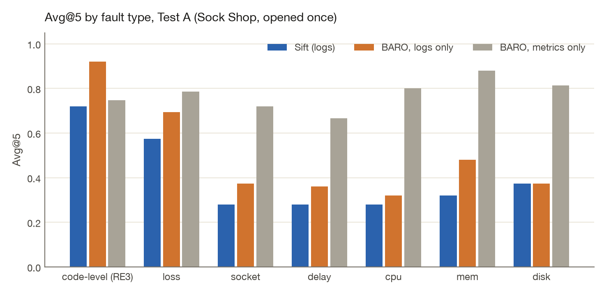
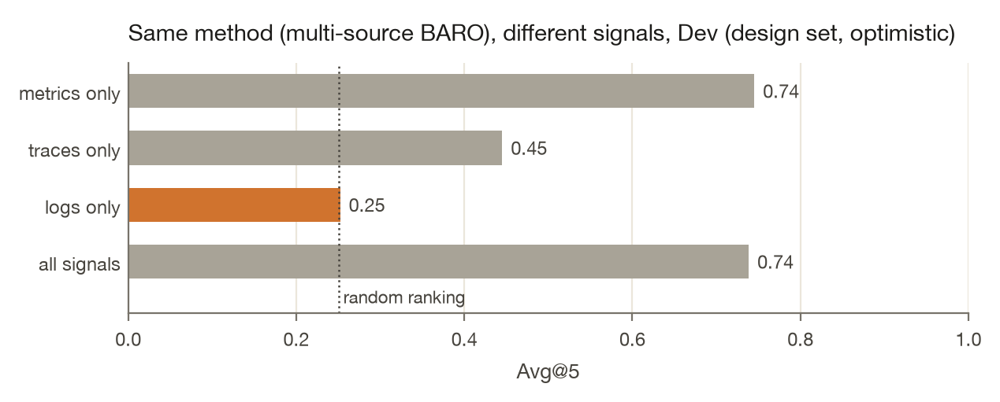

# Sift

**Can an agent find the broken service from logs alone?** Sift is a logs-only observability
engine (OTLP intake, write-ahead log, online template mining, Parquet storage, root-cause
ranking) and a pre-registered measurement of that question on injected faults in real
microservice systems.

**The first test says: not yet, and it says why.** Sift was designed and tuned on Online
Boutique, where it reached Avg@5 0.533 from logs alone, against 0.252 for
the published multi-source method given the same logs. Its configuration and seven predictions
were then committed, and a second system, Sock Shop, was opened once. There, the frozen Sift
reached Avg@5 **0.443** (AC@1 0.075) and ranked `front-end` first in
99% of cases. The published method on the same logs reached 0.555;
given metrics, 0.770. Paired difference, Sift minus that method on logs:
-0.112 (95% CI [-0.18, -0.04]). 3 of the seven predictions held.

The reason is specific and fixable, and the fix will be pre-registered before the next system is opened (below): Sift
counts every template it has never seen as evidence, and Sock Shop's front-end writes new,
one-off lines all the time, faults or not. Online Boutique's services rarely do.

### At a glance

| | |
|---|---|
| **Engine** | OTLP/HTTP intake → write-ahead log (ack after fsync) → online template mining → Parquet + rollups under one atomic manifest → DuckDB. TypeScript, one process, no services needed. |
| **Durability** | 100 SIGKILL crash runs, 20,493,200 acknowledged records: **0 lost, 0 duplicated**. The same harness catches a deliberately broken recovery. |
| **Throughput** | 315,648 records/s over OTLP/HTTP, ack p50 19.8 ms / p99 253.6 ms, on a laptop (Apple M2, 8 GB RAM, Node 24.19.0). |
| **Question** | Can logs alone rank the root-cause service? Pre-registered, three-system design, test sets opened once. |
| **Answer so far** | Not reliably: the Dev design did not transfer to the first test system (3 of 7 predictions held). Cause diagnosed; the fix will be pre-registered before the next system is opened. |
| **Agent** | Sensors fire on logs as they arrive; a deterministic gate re-measures; a local model (mlx-community/Qwen2.5-3B-Instruct-4bit, via the Vercel AI SDK) decides open or hold; each investigation runs as a Temporal workflow and opens at most one issue in Postgres. On Dev the gate cut false issues from 52.54 to 4.0 per hour; the model added little (99.4% "open"). |
| **Interop** | A stock OpenTelemetry Collector (otel/opentelemetry-collector-contrib:0.165.0, default exporter: protobuf, gzip, retries) delivered 32,531 of 32,531 lines, 0 duplicated. |
| **Try it** | `pnpm install && pnpm demo`: a real incident, end to end, in about ten seconds. |



> Every number on this page is generated from committed per-case outputs by
> `evals/src/sift_evals/report.py`; CI regenerates the page and fails if anything differs.

## Results

### Test A (Sock Shop, opened once)

| Method | Signal | AC@1 | AC@3 | Avg@5 | 95% CI | Lift over chance | Failed |
|---|---|---:|---:|---:|---:|---:|---:|
| **Sift (logs)** | logs | 0.075 | 0.608 | 0.443 | [0.34, 0.55] | +0.171 | 0 |
| Error-surge control (logs) | logs | 0.166 | 0.511 | 0.456 | [0.37, 0.55] | +0.183 | 0 |
| Multi-source BARO, logs only | logs | 0.308 | 0.592 | 0.555 | [0.44, 0.67] | +0.282 | 0 |
| Multi-source BARO, traces only | traces | 0.091 | 0.273 | 0.273 | [0.27, 0.27] | +0.000 | 0 |
| Multi-source BARO, metrics only | metrics | 0.108 | 0.958 | 0.770 | [0.73, 0.80] | +0.497 | 0 |
| Multi-source BARO, all signals | all | 0.108 | 0.958 | 0.772 | [0.74, 0.81] | +0.499 | 0 |
| BARO (metrics) | metrics | 0.100 | 0.967 | 0.768 | [0.73, 0.80] | +0.496 | 0 |

Avg@5 is the mean of AC@1..AC@5 (RCAEval's definitions), at service level. A random ranking over
the same candidates scores 0.273. Intervals are 95% paired cluster bootstraps over
(service, fault) scenarios. Every case counts: a failed run scores as a miss.

### Pre-registered predictions

| Prediction (committed before the test set was read) | Outcome | Evidence |
|---|---|---|
| Logs-only multi-source BARO stays near chance (chance inside its 95% CI) | **failed** | Avg@5 0.555 [0.44, 0.67], chance 0.273 |
| Sift beats logs-only multi-source BARO (paired 95% CI above zero) | **failed** | difference -0.112 [-0.18, -0.04] |
| Sift stays below metric-based BARO on Avg@5 | held | 0.443 vs 0.768 |
| Sift's AC@1 is at least metric-based BARO's | **failed** | 0.075 vs 0.100 |
| Sift is stronger on code-level and LOSS than on CPU, MEM, DISK | held | 0.647 vs 0.324 (mean Avg@5) |
| Most of Sift's correct top-1 picks rest on restart or redeploy evidence | **failed** | 0 of 9 |
| Sift's test Avg@5 is below its Dev Avg@5 | held | 0.443 vs 0.533 |

3 of 7 predictions held.

### Correct top-1 picks by evidence

| Evidence behind a correct top-1 pick | Cases |
|---|---:|
| other new templates | 9 |

On Dev, most correct picks came from restart or redeploy lines (start-up banners after the fault
injection restarted a container). In Sock Shop, none did.

### Where logs work and where they do not

| Fault | Cases | Sift (logs) | Multi-source BARO, logs only | Error-surge control (logs) | Multi-source BARO, metrics only | Multi-source BARO, traces only |
|---|---:|---:|---:|---:|---:|---:|
| code-level (RE3) | 30 | 0.720 | 0.920 | 0.674 | 0.747 | 0.273 |
| loss | 15 | 0.573 | 0.693 | 0.639 | 0.787 | 0.273 |
| socket | 15 | 0.280 | 0.373 | 0.315 | 0.720 | 0.273 |
| delay | 15 | 0.280 | 0.360 | 0.293 | 0.667 | 0.273 |
| cpu | 15 | 0.280 | 0.320 | 0.225 | 0.800 | 0.273 |
| mem | 15 | 0.320 | 0.480 | 0.498 | 0.880 | 0.273 |
| disk | 15 | 0.373 | 0.373 | 0.332 | 0.813 | 0.273 |

### What the logs carry: same method, different signals



Multi-source BARO is run with RCAEval's own code; only its input changes. This isolates what
each signal carries for that method. What logs carry depends on the system: on Online Boutique
(Dev) the logs-only variant is at chance (+0.002 lift), on Sock Shop it is well above
it (+0.282). Sock Shop has no traces, so its traces-only row ranks nothing and scores
as a random ranking.

### Default-pick check

A method that ranks the same service first in most cases looks accurate whenever that service is
the answer. For every method, the service it ranks first most often, against how often that
service is the answer:

| Method | Most often ranked first | Share of cases ranked first | Share of cases it is the answer |
|---|---|---:|---:|
| Sift (logs) | `front-end` | 0.99 | 0.07 |
| Error-surge control (logs) | `front-end` | 0.43 | 0.07 |
| Multi-source BARO, logs only | `front-end` | 0.42 | 0.07 |
| Multi-source BARO, traces only | `None` | 0.00 | 0.00 |
| Multi-source BARO, metrics only | `session` | 0.88 | 0.00 |
| Multi-source BARO, all signals | `session` | 0.88 | 0.00 |
| BARO (metrics) | `session` | 0.88 | 0.00 |

## Investigate before alert (the agent)

Root-cause ranking assumes someone already knows when something broke. In production nobody tells
you; the system has to notice, decide whether it matters, and only then page someone. `sift watch`
does that on the same incidents, forward-only: logs replay in event time, sensors read only what
has arrived, and the injection time is never given to Sift.

```
logs ──▶ sensors (rate, error surge, new error template; per service, Poisson z vs own baseline)
           │ signal at t
           ▼
         gate: wait 60 s, re-measure; open only if the change persists and is specific to the
           │   service, not a system-wide shift
           ▼
         local model (Vercel AI SDK, OpenAI-compatible): numbered evidence in, JSON out
           │   {verdict, service, summary, evidence}; schema-checked; citations must exist;
           │   log text is quoted as data; any unusable answer keeps the gate's decision
           ▼
         Temporal workflow: model call as a retried activity, issue as an idempotent
         Postgres insert (one issue per service and sensor per run)
```

#### Dev results (design set, 120 cases, 5-minute detection window, not tuned)

| Rung | Detected, any service | Detected, right service | Median delay | False issues per hour | Issues per case |
|---|---:|---:|---:|---:|---:|
| Raw sensors | 0.483 [0.36, 0.61] | 0.068 [0.02, 0.13] | 36 s | 52.54 | 8.25 |
| + deterministic gate | 0.475 [0.35, 0.60] | 0.110 [0.05, 0.18] | 93 s | 4.0 | 2.27 |
| + local model | 0.475 [0.35, 0.60] | 0.127 [0.06, 0.20] | 93 s | 4.0 | 2.27 |

- **The gate does the work.** It cuts false issues per hour about 13-fold
  (52.54 to 4.0) while keeping detection the same.
- **The small model adds little.** mlx-community/Qwen2.5-3B-Instruct-4bit answered "open" to 99.4% of the
  gate-passed signals it saw and named a different service than the signal in 3.9% of
  answers. Its answers were usable in 311 of 312 calls (median 3.5 s, 298
  tokens in, 59 out). Right-service detection moved from 0.110
  (gate) to 0.127 (model), inside the noise.
- **Logs see about half the faults within five minutes, and rarely name the right service
  first**: the same CPU, memory and disk blind spot as the ranking results.

Pre-registered for Test B: the same configuration, untouched, and predictions for each rung
([PREREGISTRATION.md](PREREGISTRATION.md), addendum).

## Try it

```bash
pnpm install && pnpm demo
```

Replays one real incident (a bundled RCAEval Dev case) through the full path: OTLP/HTTP intake,
write-ahead log, template mining, Parquet, ranking. It prints the ranked services, the log lines
that decided it, and the ground truth. Node 24 and pnpm only: no Docker, no download, no model.

## How it works

```
 OTel SDK / Collector / replay ──OTLP/HTTP──▶ intake ──▶ write-ahead log (fsync, then ack)
                                                              │ in WAL order
                                                              ▼
                                  template miner (online Drain, per service, versioned, lossless)
                                                              ▼
                     Parquet segments + minute rollups, committed by one atomic manifest
                                                              ▼
                     DuckDB queries ──▶ ranker: novelty, error surge, volume shift ──▶ CLI / API
```

| Module | Owns |
|---|---|
| `engine/src/logstore` | WAL, manifest, Parquet segments, compaction, rollups, the DuckDB instance |
| `engine/src/templates` | Online template mining with versioned, byte-for-byte reconstruction |
| `engine/src/detect` | Root-cause ranking |
| `engine/src/surfaces` | OTLP/HTTP intake, query API, CLI, demo |
| `evals/` | Data audit, baselines, scoring, this page |

The ranker scores each service from template counts in the 300 s before and after the alarm:
templates seen for the first time after it (mined online, so nothing is learned from the
future), error templates that grow, and log volume that departs from the system-wide trend
(a Poisson z-score, so a traffic drop everywhere is not evidence). Weights were chosen on Dev from
a logged grid of 18 settings (Dev Avg@5 from 0.445 to 0.533; chosen
`errorWeight0.5_wShift2_wSurge0.5`) and frozen before any test case was read.

## Design decisions and trade-offs

| Decision | Why | What it costs | What would change at scale |
|---|---|---|---|
| **Ack only after `fsync`, with group commit** | An acknowledged record survives a crash. Appends that arrive during one fsync share the next one, so throughput comes from batching, not from skipping the fsync. | Every ack waits for at least one fsync. | Replicate the log (quorum acks) instead of relying on one disk. |
| **The WAL is the only source of truth** | Templates, segments and rollups are all derived, so recovery is "load the last manifest, replay the log after it". One commit boundary, testable at every step. | Replay time grows with the unflushed tail (bounded by the 1 s flush). | Checkpoint per partition; truncate the log behind the manifest. |
| **JSON frames in the WAL** | Readable with standard tools while the format settles; CRC32 per frame finds torn tails. | Larger and slower to encode than a binary format (not yet measured). | Binary encoding (protobuf as received, or a columnar batch). |
| **Online, per-service template mining (Drain)** | No future data leaks into the past: a template is new only when it first arrives. Per-service trees keep one service's patterns from absorbing another's. Lossless: every line rebuilds byte for byte. | A service that always writes one-off lines looks permanently novel; this is exactly the Test A failure. Lists of different lengths become separate templates. | Score novelty against each service's own rate (Sift v2); mask variable-length lists. |
| **Parquet + DuckDB, embedded** | No servers to run, so the demo and the evaluation run anywhere; columnar storage with zstd suits template ids and parameters. | One process. Queries and flushes take one lock, so a long query delays the next flush. | Object storage for segments, a transactional catalog for the manifest, stateless query workers. |
| **Minute rollups beside raw segments** | Most questions an agent asks ("which service's errors grew?") are counts; rollups answer them without scanning raw rows. | Extra bytes per flush (to be measured with the cost work). | Pre-aggregates per tenant and service, kept longer than raw data. |
| **Exactly-once only within a stated window** | Batch ids are remembered for 10 minutes and rebuilt from the log after a crash; an older retry is rejected rather than risk a duplicate. | A sender without ids (a stock Collector) gets at-least-once. | Ids in a replicated index with a longer, configurable window. |

## Interfaces

| Surface | What it does |
|---|---|
| `POST /v1/logs` | OTLP/HTTP logs, protobuf or JSON. Optional headers `x-sift-batch-id` and `x-sift-batch-created` make retries exactly-once within the window. Errors are RFC 9457 problem bodies with a stable code; overload is `429` with `Retry-After`. |
| `POST /query` | SQL over the views `logs`, `rollups` and `templates`; `"reconstruct": true` adds each row's original line. |
| `GET /rank?at=<unix s>` | Ranked root-cause candidates with the evidence lines behind each. |
| `sift watch --logs FILE [--durable]` | Forward-only sensors, gate and model investigator; `--durable` runs each investigation as a Temporal workflow. |
| `sift worker` | Temporal worker for durable investigations (`docker compose -f deploy/docker-compose.yml up -d` starts Temporal and Postgres). |
| `sift serve \| replay \| rank \| rca \| doctor` | CLI; every command takes `--json` and runs without prompts. |

Binds `127.0.0.1` by default: there is no authentication yet, so it must not face a network.

## Scaling beyond one node (design, not built)

Sift is one process by design: the question was whether the data answers it, not how many
machines it takes. The shape it would grow into:

- **Partition** by (tenant, service). Each partition has its own log, miner state and manifest,
  so services never contend and a hot tenant can be moved alone.
- **Replicate the log** with quorum acks, keeping today's contract: an ack still means the
  record survives the loss of a machine, not just a process.
- **Segments to object storage**, the manifest in a transactional catalog (Postgres), so a
  commit stays one atomic pointer swap and old manifests stay readable.
- **Stateless query workers** read Parquet and rollups from object storage; the agent's count
  questions hit rollups first.
- **Regions as cells:** data is ingested, stored and queried in its own region; only metadata
  crosses regions.
- **Deploys and rollback:** because manifests are immutable versions, rolling back a bad
  compaction or format change is pointing back to the previous manifest; ingest nodes drain
  by flushing and handing the log tail to the next process.

## Limitations

- One node; the durability claim is process crash, not machine or power loss.
- No authentication; local use only.
- The language model is a 3B model on a laptop; it rubber-stamps the gate. A stronger model, or a
  task it is better suited to (naming the upstream service from callers' errors), is open work.
- Results cover three RCAEval systems with injected faults; Test B is still sealed.
- Throughput is one run on one laptop; the p99 ack latency has not been profiled yet.

## Durability

| Check | Result |
|---|---|
| Crash runs (SIGKILL under load, restart, resend unknown batches) | 100 |
| Random kills | 50 |
| Kills at named commit steps | `wal.beforeFsync` (10), `wal.afterFsync` (10), `store.afterSegment` (10), `store.afterManifest` (10), `store.midCompaction` (10) |
| Acknowledged records | 20,493,200 |
| Lost | **0** |
| Duplicated | **0** |
| Harness sensitivity: same runs with recovery deliberately broken | 390,200 of 826,800 records lost across 6 runs (detected) |
| Durable investigations (Temporal worker killed mid-investigation, then restarted) | killed at `llmVerdict`: 7 of 7 workflows completed, 5 issues for 5 opened names, 0 duplicated; killed at `openIssue`: 7 of 7 workflows completed, 5 issues for 5 opened names, 0 duplicated |
| Stock OpenTelemetry Collector, default exporter settings | 32,531 of 32,531 lines received, 0 missing, 0 duplicated; 702 lines arrive right-trimmed because the Collector's `filelog` receiver trims trailing whitespace by default |

The claim is "no acknowledged record lost or duplicated on process crash, for a sender that uses
batch ids within the 10-minute retry window". Acks follow `fsync`; power-loss durability on
macOS would also need `F_FULLFSYNC` and is not claimed. A stock OpenTelemetry Collector sends no
batch id, so for it the claim is at-least-once.

| Throughput (Apple M2, 8 GB RAM, Node 24.19.0) | |
|---|---|
| Direct append (WAL fsync + template mining) | 533,785 records/s |
| OTLP/HTTP protobuf, 8 senders | 315,648 records/s |
| Ack latency per 1,000-record batch | p50 19.8 ms, p99 253.6 ms |
| Ack to queryable | p99 157 ms |

Measured with 685,716 real log lines on one laptop; not extrapolated.

## Method

- **Data:** RCAEval (Pham et al., WWW 2025), pinned at commit `90b63a4`. Dev: Online Boutique
  (RE2-OB, RE3-OB). Test A: Sock Shop (RE2-SS, RE3-SS), opened once. Test B: Train Ticket,
  sealed until the next phase. Sift reads each case through an anonymised path, because RCAEval
  directory names contain the answer; a test enforces it.
- **Pre-registration:** [PREREGISTRATION.md](PREREGISTRATION.md), committed before Test A was read.
- **Candidates:** RCAEval's own candidate rule, the same for every method.
- **Coverage limit:** some root-cause services barely log. In Dev, `productcatalogservice` writes
  any log line in only 3/18 of its root-cause cases, so a logs-only method can only find
  it through the symptoms of others.

- **Corrections after the test was read** (none changes Sift's numbers): the baseline runner
  recorded an empty ranking as a failure, which scored Sock Shop's traces-only row as 0 instead of
  a random ranking; fixed and re-run. The diagnosis of Sift's `front-end` failure above is
  post-hoc analysis of Test A.

### Dev results (design set)

| Method | Signal | AC@1 | AC@3 | Avg@5 | 95% CI | Lift over chance | Failed |
|---|---|---:|---:|---:|---:|---:|---:|
| **Sift (logs)** | logs | 0.375 | 0.542 | 0.533 | [0.41, 0.66] | +0.283 | 0 |
| Sift v2 (logs) | logs | 0.392 | 0.567 | 0.558 | [0.43, 0.68] | +0.308 | 0 |
| Error-surge control (logs) | logs | 0.074 | 0.418 | 0.373 | [0.29, 0.46] | +0.123 | 0 |
| Multi-source BARO, logs only | logs | 0.150 | 0.250 | 0.252 | [0.15, 0.37] | +0.002 | 0 |
| Multi-source BARO, traces only | traces | 0.167 | 0.400 | 0.445 | [0.34, 0.56] | +0.195 | 0 |
| Multi-source BARO, metrics only | metrics | 0.117 | 0.892 | 0.745 | [0.68, 0.80] | +0.495 | 0 |
| Multi-source BARO, all signals | all | 0.117 | 0.892 | 0.738 | [0.67, 0.80] | +0.488 | 0 |
| BARO (metrics) | metrics | 0.100 | 0.900 | 0.742 | [0.68, 0.80] | +0.491 | 0 |

| Method | Most often ranked first | Share of cases ranked first | Share of cases it is the answer |
|---|---|---:|---:|
| Sift (logs) | `checkoutservice` | 0.24 | 0.15 |
| Sift v2 (logs) | `checkoutservice` | 0.25 | 0.15 |
| Error-surge control (logs) | `frontend` | 0.36 | 0.00 |
| Multi-source BARO, logs only | `recommendationservice` | 0.74 | 0.15 |
| Multi-source BARO, traces only | `frontend` | 0.57 | 0.00 |
| Multi-source BARO, metrics only | `redis` | 0.88 | 0.00 |
| Multi-source BARO, all signals | `redis` | 0.88 | 0.00 |
| BARO (metrics) | `redis` | 0.90 | 0.00 |

| Evidence behind a correct top-1 pick | Cases |
|---|---:|
| restart or redeploy | 30 |
| weak (no single item above threshold) | 8 |
| error lines | 4 |
| volume shift | 3 |

## What's next

- **Test B (Train Ticket), pre-registered, not yet opened:** Sift v1, Sift v2 (new templates
  scored against the service's own rate before the alarm; Dev Avg@5 0.558, AC@1
  0.392, from a logged grid of 18 settings spanning 0.517 to 0.558)
  and the investigate-before-alert rungs, all scored once. v1 is unchanged: re-running it on Dev
  after the v2 change gives 0 of 240 changed rankings.
- **Cost:** lossless compression and query cost on Loghub-2.0 against gzip, zstd, ClickHouse and CLP.

## Reproduce

```bash
make reproduce DRY_RUN=1   # prints disk and time estimates, downloads nothing
make reproduce             # fetch, audit, baselines, Sift, scoring, this page
```

## Errors

Every error has a stable code, the failing value on its first line and the fix on its last:
[docs/errors.md](docs/errors.md).

## Licence

MIT. RCAEval data and code: MIT (Luan Pham). OpenTelemetry protos: Apache-2.0.
