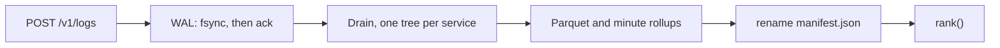

# Sift

[](https://github.com/VijayChamakuri/sift/actions/workflows/ci.yml)
[](LICENSE)


Sift is a single-process engine that ranks the broken service from logs alone: OTLP in, a write-ahead log, online template mining, Parquet, and a ranker.

On Train Ticket, opened once, that ranker reaches Avg@5 **{{tb_v2_avg5}}**. BARO on metrics, same cases, reaches **{{tb_baro_avg5}}**.

Dev is Online Boutique, used only for tuning. Test A is Sock Shop. Test B is Train Ticket. Each test set was opened once, after [PREREGISTRATION.md](PREREGISTRATION.md) was committed. Test B also needed the tag `q3-frozen`.



## Test B

{{headline_table}}

Avg@5 is the mean of AC@1 through AC@5. Chance is a random ranking, so it has no interval. v2 minus v1 is {{tb_v2_v1_diff}} (95% CI {{tb_v2_v1_ci}}). {{tb_predictions_held}} of 7 predictions held. Full tables, per-fault numbers, the watch ladder, and the crash and storage measurements are in [docs/RESULTS.md](docs/RESULTS.md).

On Sock Shop the frozen v1 config reaches Avg@5 **{{sift_avg5}}** and ranks `{{sift_top1_service}}` first in {{sift_top1_share}} of cases. It treated every unseen template as evidence, and that front-end writes one-off lines either way. v2 subtracts the service's own new-template mass in the 300 s before the alarm (`noveltyBaseline` in [`configs/rank_v2.json`](configs/rank_v2.json)). {{predictions_held}} of 7 Test A predictions held. Logs-only BARO's lift is {{logs_baro_lift}} here and {{dev_logs_lift}} on Online Boutique.


## How it works

A batch is acknowledged only after the `fsync` that covers its frame ([`engine/src/logstore/wal.ts`](engine/src/logstore/wal.ts)). Appends during that fsync share the next one. The frame is a length, a CRC32, and JSON. A torn tail is truncated on open. The same `x-sift-batch-id` is a duplicate for 10 minutes; an older retry is `SIFT-E105`.

The miner is Drain, online, one tree per service ([`engine/src/templates/drain.ts`](engine/src/templates/drain.ts)). When a cluster generalises it keeps the old token list, so `reconstruct` fills that version's `<*>` slots and the line comes back byte for byte. Past 5,000 clusters or 512 tokens, the line is stored verbatim.

Flush writes a zstd Parquet segment and minute rollups (`ts_ns // 60000000000`), then renames `manifest.json` ([`engine/src/logstore/store.ts`](engine/src/logstore/store.ts)). Recovery replays the WAL from `walOffset`. Files the manifest does not name are deleted.

The ranker uses template counts in the 300 s on each side of an alarm. From [`engine/src/detect/rank.ts`](engine/src/detect/rank.ts#L139-L145):

```ts
    const expected = vol.before * trend;
    const z = (vol.after - expected) / Math.sqrt(expected + 1);
    const shift = Math.log1p(Math.abs(z));
    if (Math.abs(z) > 3) evidence.push({ kind: "shift", templateId: null, template: "(all lines)", before: vol.before, after: vol.after, example: null });
    if (cfg.noveltyBaseline) novelty = Math.max(0, novelty - noveltyBefore);
    const score = cfg.wNovelty * novelty + cfg.wSurge * surge + cfg.wShift * shift;
```

`trend` is the system-wide change in volume, so a drop everywhere is not evidence. Weights are [`configs/rank.json`](configs/rank.json), the winner of {{tuning_trials}} Dev settings (Avg@5 {{tuning_min}} to {{tuning_max}}): `{{tuning_chosen}}`, on the edge of the grid. The grid was not extended. v2's Dev Avg@5 is {{v2_dev_avg5}}. Re-running v1 after the flag changed {{v1_repro}} rankings.

`sift watch` ([`engine/src/detect/watch.ts`](engine/src/detect/watch.ts)) is not given the injection time. Sensors are a Poisson z on rate and on errors, plus a new error template. The gate waits 60 s and keeps the signal only if it persists and is specific to the service. {{q3_model}} must return JSON; a bad answer keeps the gate. On Dev the gate takes false issues from {{q3_false_raw}} to {{q3_false_gate}} per hour. The model answers "open" to {{q3_open_share}} of what the gate passes. `--durable` runs each investigation as a Temporal workflow ([`engine/src/durable/workflows.ts`](engine/src/durable/workflows.ts)).

`POST /v1/logs` accepts OTLP protobuf or JSON, identity or gzip (output capped at 64 MiB, body limit 16 MiB). `POST /query` is SQL over `logs`, `rollups`, and `templates`. `GET /rank?at=` returns the ranking. The server binds `127.0.0.1`. There is no authentication.

{{crash_runs}} SIGKILL runs, {{crash_records}} acknowledged records, {{crash_lost}} lost, {{crash_dup}} duplicated ([`results/infra/crash.json`](results/infra/crash.json)). OTLP throughput on {{machine}}: {{tp_http}} records/s, ack p50 {{tp_p50}} ms / p99 {{tp_p99}} ms. The store is lossless on {{q2_lossless}} Loghub-2.0 systems and {{q2_summary}}.

## Design decisions and trade-offs

The first Dev ranker was discarded. It ranked `recommendationservice` first in 52 of 120 cases and `redis` in 33 ([PREREGISTRATION.md](PREREGISTRATION.md), [`results/q1/dev/history/tuning_round1.json`](results/q1/dev/history/tuning_round1.json)): unmasked identifier lists became new templates, and the volume term inflated quiet services. The miner now masks those tokens ([`engine/test/drain.test.ts`](engine/test/drain.test.ts)). The volume term is the Poisson z above. Round 2 is [`results/q1/dev/tuning.json`](results/q1/dev/tuning.json).

| Choice | Why, in the code | What it costs |
|---|---|---|
| Ack after `fsync`, group commit | An acked batch has to survive `kill -9`. Batching shares the fsync. | Ack latency is at least one fsync. On {{machine}}, 1,000-record OTLP batches: p50 {{tp_p50}} ms, p99 {{tp_p99}} ms. |
| WAL is the only source of truth | Segments, rollups, and the template snapshot are derived. Recovery loads the manifest and replays from `walOffset`. | The unflushed tail is bounded by the 1 s flush. The WAL is not trimmed after commit, so disk keeps a second copy. |
| JSON frames, CRC32 per frame | A frame is readable with ordinary tools. A bad CRC truncates the tail. | No measurement against a binary frame. |
| Drain, per service, versioned | A template is new only when that service first emits it. Reconstruction stays exact. | A service that always writes one-off lines looks novel. That is the Sock Shop failure. At the 5,000-cluster cap, new lines are stored verbatim. |
| Parquet + DuckDB in-process | The demo and the eval need no other server. | One process, one lock. A long query delays the next flush. |
| Minute rollups beside raw segments | The ranker and `sift watch` want counts. | Rollup bytes are not broken out from the rest of the store. |
| Exactly-once for 10 minutes, and only with a batch id | The id index is rebuilt from the WAL. Past the horizon the retry is rejected rather than guessed. | A stock Collector sends no batch id, so that path is at-least-once. |

## Testing

```bash
pnpm test                                          # 36 passed, vitest, engine/test
uv run --project evals pytest evals/tests -q       # 11 passed
```

[`engine/test/`](engine/test) covers the WAL, the store, Drain, HTTP, and watch. [`evals/tests/test_scoring.py`](evals/tests/test_scoring.py) covers hit@k, ties, and the anonymised path: RCAEval directory names contain the answer, and [`evals/src/sift_evals/run_sift.py`](evals/src/sift_evals/run_sift.py) copies logs to a blind path. [`evals/src/sift_evals/guard.py`](evals/src/sift_evals/guard.py) refuses a test split until `PREREGISTRATION.md` is committed. Test B also needs the tag `q3-frozen`.

[`.github/workflows/ci.yml`](.github/workflows/ci.yml) runs the tests, typecheck, a 10-run crash smoke, the demo, ruff, and a diff of this file and `docs/RESULTS.md` against a fresh `report.py` run.

## Limitations

- One process. The crash numbers are `SIGKILL` of that process. `wal.ts` notes that power loss on macOS would also need `F_FULLFSYNC`. That was not tested.
- No authentication. It binds `127.0.0.1`.
- Three RCAEval systems, injected faults, each test set opened once. `productcatalogservice` logs in {{pc_coverage}} of its Dev root-cause cases.
- Throughput is one run on {{machine}}. The p99 has not been profiled.
- The store is lossless and still larger than gzip. The untrimmed WAL is larger than the raw log.
- {{q3_model}} does not improve on the gate. On Train Ticket, right-service recall stays at {{tb_q3_recall_correct_model}}.

## What I'd do next

1. Trim the WAL after a commit and rerun the Loghub table. [`engine/bench/storage.ts`](engine/bench/storage.ts) already reports it separately because it is not trimmed.
2. Parse the header into columns before mining, and store parameters as typed columns instead of JSON. Grouping accuracy is {{q2_ga_content}} on the message and {{q2_ga_full}} on the full line.
3. Index Drain's clusters. Near the 5,000-template cap, matching scans many clusters. Thunderbird was probed on 200,000 lines for that reason.
4. Point the model at callers' error lines and score whether it names the upstream service. The gate already does the filtering.

## Run it

Node >= 24 and pnpm 10.17.1 ([`package.json`](package.json)). Python 3.12 and uv for the evals.

```bash
pnpm install --frozen-lockfile
pnpm test
pnpm build
pnpm demo

node engine/dist/surfaces/cli.js rca \
  --logs fixtures/demo/logs.parquet \
  --at 1731905504 \
  --config configs/rank.json
```

`fixtures/demo/case.json` is `re3ob_adservice_f4_1`, fault `f4`, answer `adservice`. `pnpm demo` replays those 32,531 lines through OTLP. `sift rca --help` prints the same alarm time.

```bash
uv sync --project evals --frozen
uv run --project evals pytest evals/tests -q
uv run --project evals python -m sift_evals.report

make reproduce DRY_RUN=1    # disk and time estimates, no download
make reproduce              # fetches RCAEval (~1.0 GB Dev, ~3.4 GB for all three systems)
```

`sift watch --durable` needs Temporal and Postgres:

```bash
docker compose -f deploy/docker-compose.yml up -d
```

`postgres:16.4` and `temporalio/temporal:1.10.0`, bound to `127.0.0.1`. Error codes: [`docs/errors.md`](docs/errors.md).

## Repo map

- [`engine/src/logstore/wal.ts`](engine/src/logstore/wal.ts) group-commit WAL. [`store.ts`](engine/src/logstore/store.ts) manifest, Parquet, DuckDB.
- [`engine/src/templates/drain.ts`](engine/src/templates/drain.ts) online miner. [`engine/src/detect/rank.ts`](engine/src/detect/rank.ts) v1 and v2. [`watch.ts`](engine/src/detect/watch.ts) and [`investigate.ts`](engine/src/detect/investigate.ts) sensors, gate, model.
- [`engine/src/surfaces/server.ts`](engine/src/surfaces/server.ts) HTTP. [`cli.ts`](engine/src/surfaces/cli.ts) CLI. [`demo.ts`](engine/src/surfaces/demo.ts) `pnpm demo`.
- [`engine/src/durable/workflows.ts`](engine/src/durable/workflows.ts) Temporal. [`configs/rank.json`](configs/rank.json) and [`configs/rank_v2.json`](configs/rank_v2.json) frozen weights.
- [`evals/src/sift_evals/report.py`](evals/src/sift_evals/report.py) regenerates this file and [`docs/RESULTS.md`](docs/RESULTS.md). [`scoring.py`](evals/src/sift_evals/scoring.py) AC@k and the bootstrap. [`baselines.py`](evals/src/sift_evals/baselines.py) RCAEval BARO. [`guard.py`](evals/src/sift_evals/guard.py) keeps the test sets closed.
- [`engine/bench/crash.ts`](engine/bench/crash.ts), [`throughput.ts`](engine/bench/throughput.ts), [`storage.ts`](engine/bench/storage.ts) harnesses. [`results/`](results) per-case outputs. [`fixtures/demo/`](fixtures/demo) the bundled incident. [`manifests/`](manifests) SHA-256 pins.

The same tables are also rendered to [`site/index.html`](site/index.html).

## Licence

MIT, [LICENSE](LICENSE). RCAEval: MIT (Luan Pham). OpenTelemetry protos under [`engine/proto/`](engine/proto): Apache-2.0. Loghub-2.0: CC-BY-4.0.
