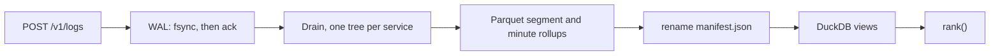

# Sift

[](https://github.com/VijayChamakuri/sift/actions/workflows/ci.yml)
[](LICENSE)


Can logs alone name the service that broke?

I wrote a single-process engine for that (OTLP in, a write-ahead log, online template mining, Parquet, a ranker) and measured it on injected faults from [RCAEval](https://github.com/phamquiluan/RCAEval) (Pham et al., WWW 2025), code pinned at `90b63a46`. Dev is Online Boutique, where I tuned. Test A is Sock Shop. Test B is Train Ticket. I opened each test set once, after [PREREGISTRATION.md](PREREGISTRATION.md) was committed. Test B also required the git tag `q3-frozen`.

Numbers below are filled in by [`evals/src/sift_evals/report.py`](evals/src/sift_evals/report.py) from `results/`. CI runs that script and fails if this file drifts.

## Result

On Train Ticket ({{tb_cases}} cases, opened once) Sift v2 reaches Avg@5 **{{tb_v2_avg5}}**. BARO on metrics, same cases, reaches **{{tb_baro_avg5}}**. v2 minus v1 is {{tb_v2_v1_diff}} (95% CI {{tb_v2_v1_ci}}). The published method on the same logs reaches {{tb_logs_avg5}}. {{tb_predictions_held}} of the 7 predictions I wrote before opening the set held.

On Sock Shop the frozen v1 config reaches Avg@5 **{{sift_avg5}}** (AC@1 {{sift_ac1}}) and ranks `{{sift_top1_service}}` first in {{sift_top1_share}} of cases. Logs-only multi-source BARO reaches {{logs_baro_avg5}}. Metric BARO reaches {{metrics_baro_avg5}}. Paired difference, v1 minus logs-only BARO: {{paired_diff}} (95% CI {{paired_ci}}). {{predictions_held}} of 7 predictions held. v1 treated every template it had never seen as evidence, and Sock Shop's front-end writes one-off lines whether or not it is the fault. v2 subtracts that service's own new-template mass in the 300 s before the alarm (`noveltyBaseline` in [`configs/rank_v2.json`](configs/rank_v2.json)).

Avg@5 is the mean of AC@1..AC@5, RCAEval's definition, at service level. A random ranking of the same candidates scores {{tb_chance_avg5}} on Train Ticket and {{chance_avg5}} on Sock Shop. Intervals are 95% paired cluster bootstraps over (service, fault), 2000 resamples, seed 0. A failed run scores as a miss at every k.

This is one Dev case, not a test-set number. `fixtures/demo/case.json` is `re3ob_adservice_f4_1`: 32,531 lines, fault `f4`, answer `adservice`, alarm `1731905504`. On Linux with Node 24.22.3, after `pnpm install` and `pnpm build`, I ran:

```bash
node engine/dist/surfaces/cli.js rca \
  --logs fixtures/demo/logs.parquet \
  --at 1731905504 \
  --config configs/rank.json
```

It printed `adservice` first (score 28.23), then `recommendationservice` (12.80), then `frontend` (6.10). The same command with `--json` reported `ingestMs` 115, `records` 32531, `templates` 91. `pnpm demo` sends that file through OTLP/HTTP at 60x ([`engine/src/surfaces/demo.ts`](engine/src/surfaces/demo.ts)) and printed `finished in 10.6 s` and `ranked #1`.

### Test B (Train Ticket, opened once)

{{tb_table}}

{{tb_no_logs}} case ships with no `logs.parquet`. Every logs-only method scores it as a miss. RCAEval's own code fails on one other case for two baseline variants. That is a miss too. v1's AC@1 is {{tb_v1_ac1}} and v2's is {{tb_v2_ac1}}. v1 minus logs-only BARO is {{tb_v1_logs_diff}} (95% CI {{tb_v1_logs_ci}}).

{{tb_fault_table}}

### Test A (Sock Shop, opened once)

{{head_table}}

{{fault_table}}


[`manifests/rcaeval-test_a.json`](manifests/rcaeval-test_a.json) has no `traces.parquet` entries, so the traces-only row matches chance ({{chance_avg5}}). Logs-only BARO's lift is {{logs_baro_lift}} here and {{dev_logs_lift}} on Online Boutique. What the logs carry depends on the system.

{{evidence_table}}

On Dev, most correct top-1 picks were restart or redeploy lines (the injector had restarted a container). On Sock Shop, none were.

## How it works



A batch is acknowledged only after the `fsync` that covers its frame ([`engine/src/logstore/wal.ts`](engine/src/logstore/wal.ts)). Appends that arrive during that fsync share the next one. The frame is length, CRC32, then UTF-8 JSON. On open, a torn tail is truncated. The id index is rebuilt from the frames, so a retry with the same `x-sift-batch-id` is a duplicate for 10 minutes. An older retry is `SIFT-E105`, not a second write.

The miner is Drain (He et al., ICWS 2017), online, per service ([`engine/src/templates/drain.ts`](engine/src/templates/drain.ts)). Tokens that look like numbers, hex, UUIDs, IPs, or identifiers are masked for matching. When a cluster generalises, it keeps the old token list as a version. `reconstruct` fills that version's `<*>` slots, so the line comes back byte for byte. Past 5,000 clusters per service, or 512 tokens, the line is stored verbatim.

Flush writes a zstd Parquet segment and minute rollups (`ts_ns // 60000000000`), then renames one manifest ([`engine/src/logstore/store.ts`](engine/src/logstore/store.ts)). Recovery loads that manifest and replays the WAL from `walOffset`. Files the manifest does not name are deleted. Queries and the next flush share one lock.

The ranker reads template counts in the 300 s before and after an alarm time `T`. Novelty is templates whose first line is at or after `T`. Surge is an existing error template that grew. Shift is the service's volume against the system-wide trend, as a Poisson z, so a traffic drop everywhere is not evidence. From [`engine/src/detect/rank.ts`](engine/src/detect/rank.ts#L139-L145):

```ts
    const expected = vol.before * trend;
    const z = (vol.after - expected) / Math.sqrt(expected + 1);
    const shift = Math.log1p(Math.abs(z));
    if (Math.abs(z) > 3) evidence.push({ kind: "shift", templateId: null, template: "(all lines)", before: vol.before, after: vol.after, example: null });
    if (cfg.noveltyBaseline) novelty = Math.max(0, novelty - noveltyBefore);
    const score = cfg.wNovelty * novelty + cfg.wSurge * surge + cfg.wShift * shift;
```

Weights live in [`configs/rank.json`](configs/rank.json). I picked them on Dev from {{tuning_trials}} logged settings (Avg@5 {{tuning_min}} to {{tuning_max}}). The winner was `{{tuning_chosen}}`, on the edge of the grid. I did not extend the grid. v2's grid is [`results/q1/dev/tuning_v2.json`](results/q1/dev/tuning_v2.json): Dev Avg@5 {{v2_tuning_min}} to {{v2_tuning_max}}, chosen config Avg@5 {{v2_dev_avg5}}, AC@1 {{v2_dev_ac1}}. Re-running v1 on Dev after the v2 flag changed {{v1_repro}} rankings ([`results/q1/dev/v1_reproduction.json`](results/q1/dev/v1_reproduction.json)).

`sift watch` does not receive the injection time ([`engine/src/detect/watch.ts`](engine/src/detect/watch.ts)). Every 15 s of event time it scores, per service, a Poisson z on line rate and on error rate against that service's own previous 300 s, plus a new error template. The gate in [`engine/src/detect/investigate.ts`](engine/src/detect/investigate.ts) waits 60 s and keeps the signal only if it persists and is not a system-wide shift. A local model ({{q3_model}}, Vercel AI SDK, OpenAI-compatible HTTP) sees numbered evidence and must return `{verdict, service, summary, evidence}`. Log text is quoted as data. A bad answer keeps the gate's decision. With `--durable`, that call and the Postgres insert are a Temporal workflow ([`engine/src/durable/workflows.ts`](engine/src/durable/workflows.ts)). One issue per service and sensor per run.

HTTP is [`engine/src/surfaces/server.ts`](engine/src/surfaces/server.ts). It binds `127.0.0.1`. There is no authentication.

| Route or command | What it does |
|---|---|
| `POST /v1/logs` | OTLP/HTTP, protobuf or JSON, identity or gzip. Gzip output is capped at 64 MiB. Body limit 16 MiB. Overload is `429` with `Retry-After`. |
| `POST /query` | SQL over `logs`, `rollups`, `templates`. `"reconstruct": true` adds the original line. |
| `GET /rank?at=<unix s>` | Ranked services and the evidence lines. |
| `GET /healthz` | `walOffset` and pending rows. |
| `sift serve`, `replay`, `rank`, `rca`, `watch`, `worker`, `doctor` | CLI. Every command takes `--json`. `sift rca --help` prints the demo file and alarm `1731905504`. |

## Decisions

I tried a first ranker on Dev and threw it out. [`results/q1/dev/history/tuning_round1.json`](results/q1/dev/history/tuning_round1.json) and the note in [PREREGISTRATION.md](PREREGISTRATION.md): it ranked `recommendationservice` first in 52 of 120 Dev cases and `redis` in 33, because unmasked identifier lists became new templates and the volume term inflated quiet services. The miner now masks those tokens ([`engine/test/drain.test.ts`](engine/test/drain.test.ts)), and the volume term is the Poisson z above. Round 2 is [`results/q1/dev/tuning.json`](results/q1/dev/tuning.json).

| Choice | Why this, in the code | What it costs |
|---|---|---|
| Ack after `fsync`, group commit | An acked batch has to survive `kill -9`. Batching shares the fsync. | Ack latency is at least one fsync. On {{machine}}, 1,000-record batches over OTLP: p50 {{tp_p50}} ms, p99 {{tp_p99}} ms. |
| WAL is the only source of truth | Segments, rollups, and the template snapshot are derived. Recovery is "load the manifest, replay after `walOffset`". | The unflushed tail is bounded by the 1 s flush. The WAL is not trimmed after commit, so disk keeps a second copy. |
| JSON frames, CRC32 per frame | I wanted to read the log while the format moved. A bad CRC truncates the tail. | I have not measured a binary frame against this one. |
| Drain, per service, versioned | A template is new only when that service first emits it. Nothing is learned from lines that have not arrived. Reconstruction stays exact. | A service that always writes one-off lines looks novel. That is the Sock Shop failure. Lists of different lengths stay different templates. At the 5,000-cluster cap, matching slows down and new lines are stored verbatim. |
| Parquet + DuckDB in-process | The demo and the eval need no other server. | One process, one lock. A long query delays the next flush. |
| Minute rollups next to raw segments | The watch path and the ranker want counts. | I did not break rollup bytes out from the rest of the store. The whole store is below. |
| Exactly-once only inside 10 minutes, and only with a batch id | The id index is rebuilt from the WAL, so it survives a crash. Past the horizon I reject the retry rather than guess. | A stock Collector sends no batch id. For that sender the claim is at-least-once. |

## Evaluation

### Tests I ran here

On 12 Nov 2026, Linux, Node 24.22.3, Python 3.12.3:

- `pnpm test` (vitest, [`engine/vitest.config.ts`](engine/vitest.config.ts)): 36 passed, 5 files.
- `uv run --project evals pytest evals/tests -q`: 11 passed.
- `uv run --project evals ruff check evals`: clean.
- `pnpm --filter sift-engine typecheck`: clean.
- `make reproduce DRY_RUN=1`: prints the stages and does not download. It estimates ~1.0 GB for Dev and ~3.4 GB for all three systems. I did not run `make reproduce`.

| File | What it checks |
|---|---|
| [`engine/test/wal.test.ts`](engine/test/wal.test.ts) | Ack order, torn tail, batch-id dedup across restart, `SIFT-E105`, backpressure `SIFT-E103`. |
| [`engine/test/store.test.ts`](engine/test/store.test.ts) | Empty-store queries, lossless reconstruct, restart, crash leftovers deleted, compaction vs rollups. |
| [`engine/test/drain.test.ts`](engine/test/drain.test.ts) | Byte-for-byte reconstruct, versions, per-service online mining, identifier mask, verbatim past the cap. |
| [`engine/test/server.test.ts`](engine/test/server.test.ts) | Protobuf, JSON, gzip, bad bodies as RFC 9457, dedup, reconstructed query rows. |
| [`engine/test/watch.test.ts`](engine/test/watch.test.ts) | Schema check, quoted log text, flood, silence, steady traffic, cutoff, determinism. |
| [`evals/tests/test_scoring.py`](evals/tests/test_scoring.py) | Hit@k, tied tail, failure as a miss, bootstrap seed, disjoint splits, anonymised paths. |
| [`evals/tests/test_q2.py`](evals/tests/test_q2.py) | Loghub grouping accuracy: perfect, merged, split. |

Sift never sees the case directory name. Those names contain the answer. [`evals/src/sift_evals/run_sift.py`](evals/src/sift_evals/run_sift.py) copies the logs to a blind path. `test_sift_never_sees_the_case_name_or_answer` checks the command line. [`evals/src/sift_evals/guard.py`](evals/src/sift_evals/guard.py) refuses a test split until `PREREGISTRATION.md` is committed and clean (`SIFT-E301`, `SIFT-E302`). Test B also needs the tag `q3-frozen` (`SIFT-E303`).

Scoring is [`evals/src/sift_evals/scoring.py`](evals/src/sift_evals/scoring.py). The candidate set is RCAEval's own rule, shared by every method. Unranked candidates tie at the bottom and score as the expected rank under a random tie-break. I re-ran the Sock Shop baselines after fixing a bug that had scored an empty ranking as 0 instead of chance. That changed the traces-only row, not Sift's numbers. The front-end diagnosis is post-hoc. On Test B the baselines ran twice: the first run shared a cache directory with a stale process and wrote a corrupt file, so I discarded it before scoring. The agent run was restarted once after a machine reboot, before it had written output.

### Predictions

{{predictions_table}}

{{tb_predictions_table}}

### Design set (Online Boutique, 120 cases)

This is where I tuned, so it is optimistic. v1 Avg@5 {{dev_sift_avg5}} against logs-only BARO {{dev_logs_avg5}}. Test A v1 was {{sift_avg5}}.

{{dev_table}}

{{dev_evidence_table}}

`productcatalogservice` writes any log line in {{pc_coverage}} of its Dev root-cause cases ([`results/audit/audit.json`](results/audit/audit.json)). A logs-only method can only find it from other services' symptoms.

### Watch, without being told the alarm time

Dev, 120 cases, 300 s detection window, config not tuned (`DEFAULT_WATCH_CONFIG` in `watch.ts`):

{{q3_table}}

The gate takes false issues from {{q3_false_raw}} to {{q3_false_gate}} per hour (about {{q3_false_cut}}-fold). {{q3_model}} answered "open" to {{q3_open_share}} of the gate-passed signals it saw, and named a different service in {{q3_renamed}} of answers. Usable answers: {{q3_usable}}. Median {{q3_latency}}, {{q3_tokens_in}} tokens in, {{q3_tokens_out}} out. Right-service detection moved from {{q3_recall_correct_gate}} (gate) to {{q3_recall_correct_model}} (model).

Test B, same config:

{{tb_q3_table}}

{{tb_q3_text}}

A false issue opened before the fault hides a later real one, because repeats for the same service and sensor count once. The gate removes some of those early issues, so its recall can exceed the raw sensors. Train Ticket is noisier ({{tb_q3_false_raw}} false issues per hour raw). The five-fold prediction is the failed row in the Test B prediction table.

### Crash, collector, throughput

These are the committed harness outputs. I did not rerun the 100-kill harness, the collector, or the throughput benchmark on this machine.

| Check | Result | File |
|---|---|---|
| SIGKILL under load, restart, resend unknown batches | {{crash_runs}} runs, {{crash_records}} acked records, {{crash_lost}} lost, {{crash_dup}} duplicated | [`results/infra/crash.json`](results/infra/crash.json) |
| Of which random / named steps | {{crash_random}} random; {{crash_points}} | same |
| Same harness with recovery deliberately broken | {{sens_lost}} of {{sens_acked}} records lost across {{sens_runs}} runs | [`results/infra/crash_sensitivity.json`](results/infra/crash_sensitivity.json) |
| Temporal worker killed mid-investigation | {{durable_summary}} | [`results/infra/durable.json`](results/infra/durable.json) |
| Stock Collector, default exporter | {{collector_image}}: {{collector_received}} of {{collector_lines}} lines, {{collector_missing}} missing, {{collector_dup}} duplicated. {{collector_trimmed}} lines arrive right-trimmed because `filelog` trims trailing whitespace | [`results/infra/collector.json`](results/infra/collector.json) |

Durability claim: no acknowledged record lost or duplicated on process crash, for a sender that retries with a batch id inside 10 minutes. Acks follow `fsync`. I do not claim power-loss durability. `wal.ts` notes that macOS would also need `F_FULLFSYNC`.

| Throughput, {{machine}}, {{tp_records}} real lines, one run | |
|---|---|
| Direct append (WAL fsync + mining) | {{tp_direct}} records/s |
| OTLP/HTTP protobuf, 8 senders | {{tp_http}} records/s |
| Ack latency, 1,000-record batches | p50 {{tp_p50}} ms, p99 {{tp_p99}} ms |
| Ack to queryable | p99 {{tp_fresh_p99}} ms |

Source: [`results/infra/throughput.json`](results/infra/throughput.json). Not extrapolated.

### What the store costs (Loghub-2.0)

Loghub-2.0 (Jiang et al., ISSTA 2024; Zenodo 8275861, CC-BY-4.0). {{q2_systems}} systems, {{q2_lines}} lines, {{q2_raw_gb}} GB raw, with ground-truth templates. Each raw file goes through the store and through gzip, zstd, and ClickHouse. Every stored line is rebuilt and the SHA-256 of that stream is compared with the input. Sizes are MB. Machine recorded in [`results/q2/environment.json`](results/q2/environment.json): arm64 macOS. I did not rerun this ingest here.

{{q2_table}}

Lossless on {{q2_lossless}} systems. The store is {{q2_summary}}. gzip -6 is {{q2_ratio_gzip}}× smaller than raw. ClickHouse ZSTD(3) is {{q2_ratio_ch}}×. Grouping accuracy, Loghub's definition, averages {{q2_ga_content}} on the benchmark's message text and {{q2_ga_full}} on the full line the store keeps. The miner was written for OTLP bodies, where time and severity are separate fields. The WAL column is a second copy: it is not deleted after commit. {{q2_not_run}}

## Limitations

- One process. The crash numbers are `SIGKILL` of that process, not a disk losing power.
- No authentication. It binds `127.0.0.1` and must not face a network.
- Three RCAEval systems, injected faults, each test set opened once. Some root-cause services barely log (`productcatalogservice`, {{pc_coverage}} on Dev).
- Throughput is one laptop run. I have not profiled the p99.
- The store is lossless and still larger than gzip on these files. The untrimmed WAL is larger than the raw log.
- {{q3_model}} does not improve on the gate. On Train Ticket, right-service recall stays at {{tb_q3_recall_correct_model}}.

## What I'd do next

1. Trim the WAL after a commit and rerun the Loghub table. [`engine/bench/storage.ts`](engine/bench/storage.ts) already reports it separately because it is not trimmed.
2. Parse the header into columns before mining, and store parameters as typed columns instead of JSON text. That is the gap between grouping accuracy {{q2_ga_content}} on the message and {{q2_ga_full}} on the full line.
3. Index Drain's clusters. Near the 5,000-template cap, matching scans many clusters. That is why Thunderbird was probed on 200,000 lines instead of run in full.
4. Point the model at the callers' error lines and score whether it names the upstream service. The gate already does the filtering.

## Run it

Node >= 24, pnpm 10.17.1 (see [`package.json`](package.json)). Python 3.12 and [uv](https://docs.astral.sh/uv/) for the evals.

```bash
pnpm install --frozen-lockfile
pnpm test
pnpm --filter sift-engine typecheck
pnpm build
pnpm demo

node engine/dist/surfaces/cli.js rca \
  --logs fixtures/demo/logs.parquet \
  --at 1731905504 \
  --config configs/rank.json

node engine/dist/surfaces/cli.js doctor --json
```

I ran those on this checkout. `doctor` reported Node 24.22.3 ok and `SIFT_LLM_BASE_URL` unset, so the model rung is skipped. I did not start Docker.

```bash
uv sync --project evals --frozen
uv run --project evals pytest evals/tests -q
uv run --project evals ruff check evals
uv run --project evals python -m sift_evals.report   # rewrites README.md from results/

make reproduce DRY_RUN=1
make reproduce    # downloads RCAEval; I did not run this here
```

Durable investigations need Temporal and Postgres:

```bash
docker compose -f deploy/docker-compose.yml up -d
```

Images in that file: `postgres:16.4` and `temporalio/temporal:1.10.0`, bound to `127.0.0.1`. I did not run compose here.

Error codes, each with the failing value and a `fix:` line: [`docs/errors.md`](docs/errors.md).

## Repo map

| Path | What it is |
|---|---|
| [`engine/src/logstore/wal.ts`](engine/src/logstore/wal.ts) | Group-commit WAL, CRC, dedup horizon. |
| [`engine/src/logstore/store.ts`](engine/src/logstore/store.ts) | Manifest, Parquet, rollups, DuckDB, compaction. |
| [`engine/src/templates/drain.ts`](engine/src/templates/drain.ts) | Online miner, versioned, lossless. |
| [`engine/src/detect/rank.ts`](engine/src/detect/rank.ts) | v1 and v2 ranker. |
| [`engine/src/detect/watch.ts`](engine/src/detect/watch.ts) | Forward-only sensors. |
| [`engine/src/detect/investigate.ts`](engine/src/detect/investigate.ts) | Gate, evidence, model schema. |
| [`engine/src/durable/workflows.ts`](engine/src/durable/workflows.ts) | Temporal workflow per investigation. |
| [`engine/src/surfaces/server.ts`](engine/src/surfaces/server.ts) | OTLP and query HTTP. |
| [`engine/src/surfaces/cli.ts`](engine/src/surfaces/cli.ts) | CLI. |
| [`engine/src/surfaces/demo.ts`](engine/src/surfaces/demo.ts) | `pnpm demo`. |
| [`engine/src/errors.ts`](engine/src/errors.ts) | Stable error codes. |
| [`engine/bench/crash.ts`](engine/bench/crash.ts) | SIGKILL harness. |
| [`engine/bench/throughput.ts`](engine/bench/throughput.ts) | Ack rate and latency. |
| [`engine/bench/storage.ts`](engine/bench/storage.ts) | Loghub byte measurement. |
| [`configs/rank.json`](configs/rank.json) | Frozen v1 weights. |
| [`configs/rank_v2.json`](configs/rank_v2.json) | v2, `noveltyBaseline: true`. |
| [`PREREGISTRATION.md`](PREREGISTRATION.md) | Predictions, written before each test set. |
| [`evals/src/sift_evals/report.py`](evals/src/sift_evals/report.py) | Regenerates this README. |
| [`evals/src/sift_evals/scoring.py`](evals/src/sift_evals/scoring.py) | AC@k, Avg@5, bootstrap. |
| [`evals/src/sift_evals/baselines.py`](evals/src/sift_evals/baselines.py) | RCAEval BARO, per signal. |
| [`evals/src/sift_evals/guard.py`](evals/src/sift_evals/guard.py) | Refuses an early look at a test set. |
| [`manifests/`](manifests) | SHA-256 pins for RCAEval files. |
| [`results/`](results) | Per-case outputs the numbers come from. |
| [`fixtures/demo/`](fixtures/demo) | The bundled incident. |
| [`deploy/docker-compose.yml`](deploy/docker-compose.yml) | Local Temporal and Postgres. |
| [`docs/errors.md`](docs/errors.md) | Error catalogue. |
| [`.github/workflows/ci.yml`](.github/workflows/ci.yml) | Typecheck, vitest, a 10-run crash smoke, the demo, pytest, ruff, README drift. |

The same tables are rendered to [`site/index.html`](site/index.html) (GitHub Pages: <https://vijaychamakuri.github.io/sift/>).

## Licence

MIT, [LICENSE](LICENSE). RCAEval code and data: MIT (Luan Pham). OpenTelemetry protos under [`engine/proto/`](engine/proto): Apache-2.0. Loghub-2.0: CC-BY-4.0.
