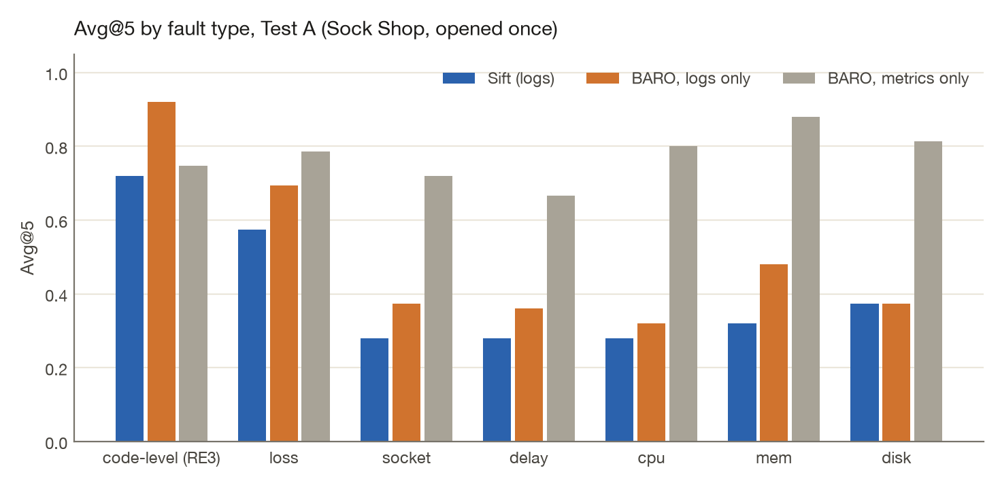
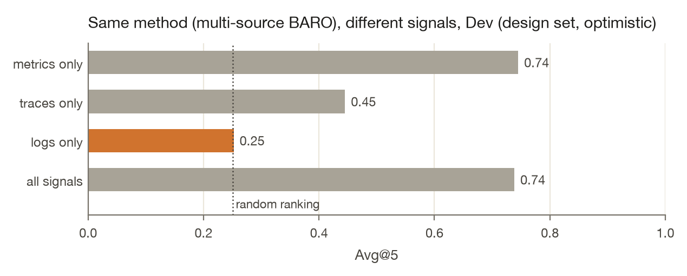

# Results

Every number here is filled by [`evals/src/sift_evals/report.py`](../evals/src/sift_evals/report.py) from `results/`. CI regenerates this file and fails if it drifts. The short version is the [README](../README.md).

Dev is Online Boutique (tuning only). Test A is Sock Shop. Test B is Train Ticket. Each test set was opened once, after [`PREREGISTRATION.md`](../PREREGISTRATION.md) was committed. Test B also needed the tag `q3-frozen`.

Avg@5 is the mean of AC@1 through AC@5, RCAEval's definition, at service level. A failed run scores as a miss at every k. Intervals are 95% paired cluster bootstraps over (service, fault), 2000 resamples, seed 0.

## Test B (Train Ticket, opened once)

120 cases. A random ranking scores 0.044.

| Method | Signal | AC@1 | AC@3 | Avg@5 | 95% CI | Lift over chance | Failed |
|---|---|---:|---:|---:|---:|---:|---:|
| **Sift v1 (logs)** | logs | 0.292 | 0.358 | 0.348 | [0.21, 0.49] | +0.304 | 1 |
| Sift v2 (logs) | logs | 0.308 | 0.408 | 0.403 | [0.28, 0.54] | +0.359 | 1 |
| Error-surge control (logs) | logs | 0.075 | 0.167 | 0.194 | [0.12, 0.28] | +0.150 | 1 |
| Multi-source BARO, logs only | logs | 0.275 | 0.359 | 0.343 | [0.21, 0.48] | +0.299 | 1 |
| Multi-source BARO, traces only | traces | 0.492 | 0.867 | 0.797 | [0.73, 0.85] | +0.753 | 0 |
| Multi-source BARO, metrics only | metrics | 0.750 | 0.867 | 0.853 | [0.78, 0.92] | +0.809 | 0 |
| Multi-source BARO, all signals | all | 0.750 | 0.875 | 0.870 | [0.80, 0.93] | +0.826 | 1 |
| BARO (metrics) | metrics | 0.758 | 0.875 | 0.853 | [0.78, 0.92] | +0.809 | 0 |

1 case ships with no `logs.parquet`. Every logs-only method scores it as a miss. RCAEval's own code fails on one other case for two baseline variants. That is a miss too. v1's AC@1 is 0.292 and v2's is 0.308. v2 minus v1 is +0.055 (95% CI [+0.003, +0.105]). v1 minus logs-only BARO is +0.005 (95% CI [-0.035, +0.048]).

| Fault | Cases | Sift v1 (logs) | Multi-source BARO, logs only | Error-surge control (logs) | Multi-source BARO, metrics only | Multi-source BARO, traces only |
|---|---:|---:|---:|---:|---:|---:|
| code-level (RE3) | 30 | 1.000 | 0.987 | 0.354 | 0.940 | 0.927 |
| loss | 15 | 0.147 | 0.149 | 0.188 | 0.613 | 0.573 |
| socket | 15 | 0.000 | 0.054 | 0.121 | 0.813 | 0.853 |
| delay | 15 | 0.173 | 0.054 | 0.004 | 0.653 | 0.867 |
| cpu | 15 | 0.240 | 0.231 | 0.227 | 0.880 | 0.840 |
| mem | 15 | 0.227 | 0.175 | 0.093 | 0.987 | 0.693 |
| disk | 15 | 0.000 | 0.109 | 0.213 | 1.000 | 0.693 |

| Method | Most often ranked first | Share of cases ranked first | Share of cases it is the answer |
|---|---|---:|---:|
| Sift v1 (logs) | `ts-order-other-service` | 0.15 | 0.00 |
| Sift v2 (logs) | `ts-order-other-service` | 0.14 | 0.00 |
| Error-surge control (logs) | `ts-travel-service` | 0.15 | 0.15 |
| Multi-source BARO, logs only | `ts-order-other-service` | 0.31 | 0.00 |
| Multi-source BARO, traces only | `ts-route-service` | 0.19 | 0.28 |
| Multi-source BARO, metrics only | `ts-route-service` | 0.25 | 0.28 |
| Multi-source BARO, all signals | `ts-route-service` | 0.25 | 0.28 |
| BARO (metrics) | `ts-route-service` | 0.27 | 0.28 |

| Prediction (addendum, committed and tagged before Test B was read) | Outcome | Evidence |
|---|---|---|
| Sift v2 beats Sift v1 on Avg@5 (paired 95% CI above zero) | held | 0.403 vs 0.348, difference +0.055 [+0.003, +0.105] |
| Sift v2 ranks no single service first in more than half of the cases | held | `ts-order-other-service` first in 14% |
| Sift v2 stays below metric-based BARO on Avg@5 | held | 0.403 vs 0.853 |
| Sift v2 beats logs-only multi-source BARO (paired 95% CI above zero) | held | difference +0.060 [+0.013, +0.115] |
| The gate cuts false issues per hour at least five-fold and loses at most 0.05 of any-service recall | **failed** | 108.81 to 43.55 per hour (2.5-fold); recall 0.692 to 0.792 |
| The model rung's right-service recall is within 0.05 of the gate's | held | 0.117 vs 0.117 (+0.000) |
| The model answers "open" to at least 90% of the gate-passed signals it sees | held | 99.3% of 922 calls |

6 of 7 predictions held.

### Watch (same configuration, alarm time not given)

| Rung | Detected, any service | Detected, right service | Median delay | False issues per hour | Issues per case |
|---|---:|---:|---:|---:|---:|
| Raw sensors | 0.692 [0.59, 0.79] | 0.117 [0.03, 0.23] | 59 s | 108.81 | 18.48 |
| + deterministic gate | 0.792 [0.71, 0.87] | 0.117 [0.03, 0.23] | 84 s | 43.55 | 10.54 |
| + local model | 0.792 [0.71, 0.87] | 0.117 [0.03, 0.23] | 84 s | 43.42 | 10.54 |

On Train Ticket the gate took false issues from 108.81 to 43.55 per monitored hour, while detection of any service went from 0.692 to 0.792. Right-service detection was 0.117 with the gate and 0.117 with the model, which answered "open" to 99.3% of the 922 gate-passed signals it saw.

A false issue opened before the fault hides a later real one, because repeats for the same service and sensor count once. The gate removes some of those early issues, so its recall can exceed the raw sensors. Train Ticket is noisier (108.81 false issues per hour raw). The five-fold prediction is the failed row above.

## Test A (Sock Shop, opened once)

120 cases. A random ranking scores 0.273.

| Method | Signal | AC@1 | AC@3 | Avg@5 | 95% CI | Lift over chance | Failed |
|---|---|---:|---:|---:|---:|---:|---:|
| **Sift v1 (logs)** | logs | 0.075 | 0.608 | 0.443 | [0.34, 0.55] | +0.171 | 0 |
| Error-surge control (logs) | logs | 0.166 | 0.511 | 0.456 | [0.37, 0.55] | +0.183 | 0 |
| Multi-source BARO, logs only | logs | 0.308 | 0.592 | 0.555 | [0.44, 0.67] | +0.282 | 0 |
| Multi-source BARO, traces only | traces | 0.091 | 0.273 | 0.273 | [0.27, 0.27] | +0.000 | 0 |
| Multi-source BARO, metrics only | metrics | 0.108 | 0.958 | 0.770 | [0.73, 0.80] | +0.497 | 0 |
| Multi-source BARO, all signals | all | 0.108 | 0.958 | 0.772 | [0.74, 0.81] | +0.499 | 0 |
| BARO (metrics) | metrics | 0.100 | 0.967 | 0.768 | [0.73, 0.80] | +0.496 | 0 |

| Fault | Cases | Sift v1 (logs) | Multi-source BARO, logs only | Error-surge control (logs) | Multi-source BARO, metrics only | Multi-source BARO, traces only |
|---|---:|---:|---:|---:|---:|---:|
| code-level (RE3) | 30 | 0.720 | 0.920 | 0.674 | 0.747 | 0.273 |
| loss | 15 | 0.573 | 0.693 | 0.639 | 0.787 | 0.273 |
| socket | 15 | 0.280 | 0.373 | 0.315 | 0.720 | 0.273 |
| delay | 15 | 0.280 | 0.360 | 0.293 | 0.667 | 0.273 |
| cpu | 15 | 0.280 | 0.320 | 0.225 | 0.800 | 0.273 |
| mem | 15 | 0.320 | 0.480 | 0.498 | 0.880 | 0.273 |
| disk | 15 | 0.373 | 0.373 | 0.332 | 0.813 | 0.273 |

[`manifests/rcaeval-test_a.json`](../manifests/rcaeval-test_a.json) has no `traces.parquet` entries, so the traces-only row matches chance (0.273). Logs-only BARO's lift is +0.282 here and +0.002 on Online Boutique.

| Evidence behind a correct top-1 pick | Cases |
|---|---:|
| other new templates | 9 |

On Dev, most correct top-1 picks were restart or redeploy lines. On Sock Shop, none were. v1 ranked `front-end` first in 99% of cases. Paired difference, v1 minus logs-only BARO: -0.112 (95% CI [-0.18, -0.04]).

| Method | Most often ranked first | Share of cases ranked first | Share of cases it is the answer |
|---|---|---:|---:|
| Sift v1 (logs) | `front-end` | 0.99 | 0.07 |
| Error-surge control (logs) | `front-end` | 0.43 | 0.07 |
| Multi-source BARO, logs only | `front-end` | 0.42 | 0.07 |
| Multi-source BARO, traces only | `None` | 0.00 | 0.00 |
| Multi-source BARO, metrics only | `session` | 0.88 | 0.00 |
| Multi-source BARO, all signals | `session` | 0.88 | 0.00 |
| BARO (metrics) | `session` | 0.88 | 0.00 |

| Prediction (committed before the test set was read) | Outcome | Evidence |
|---|---|---|
| Logs-only multi-source BARO stays near chance (chance inside its 95% CI) | **failed** | Avg@5 0.555 [0.44, 0.67], chance 0.273 |
| Sift beats logs-only multi-source BARO (paired 95% CI above zero) | **failed** | difference -0.112 [-0.18, -0.04] |
| Sift stays below metric-based BARO on Avg@5 | held | 0.443 vs 0.768 |
| Sift's AC@1 is at least metric-based BARO's | **failed** | 0.075 vs 0.100 |
| Sift is stronger on code-level and LOSS than on CPU, MEM, DISK | held | 0.647 vs 0.324 (mean Avg@5) |
| Most of Sift's correct top-1 picks rest on restart or redeploy evidence | **failed** | 0 of 9 |
| Sift's test Avg@5 is below its Dev Avg@5 | held | 0.443 vs 0.533 |

3 of 7 predictions held.

After Test A, an empty ranking had been scored as 0 instead of chance. The baselines were re-run. Sift's numbers did not change. The front-end diagnosis is post-hoc. On Test B the first baseline run shared a cache directory with a stale process and was discarded before scoring. The agent run was restarted once after a reboot, before it wrote output.

## Dev (Online Boutique, design set)

v1 Avg@5 0.533 against logs-only BARO 0.252. v2 Avg@5 0.558, AC@1 0.392. The v2 grid spanned 0.517 to 0.558 ([`results/q1/dev/tuning_v2.json`](../results/q1/dev/tuning_v2.json)). v1 weights were chosen from 18 settings, Avg@5 0.445 to 0.533, `errorWeight0.5_wShift2_wSurge0.5` ([`results/q1/dev/tuning.json`](../results/q1/dev/tuning.json)). Re-running v1 after the v2 flag changed 0 of 240 rankings ([`results/q1/dev/v1_reproduction.json`](../results/q1/dev/v1_reproduction.json)).

| Method | Signal | AC@1 | AC@3 | Avg@5 | 95% CI | Lift over chance | Failed |
|---|---|---:|---:|---:|---:|---:|---:|
| **Sift v1 (logs)** | logs | 0.375 | 0.542 | 0.533 | [0.41, 0.66] | +0.283 | 0 |
| Sift v2 (logs) | logs | 0.392 | 0.567 | 0.558 | [0.43, 0.68] | +0.308 | 0 |
| Error-surge control (logs) | logs | 0.074 | 0.418 | 0.373 | [0.29, 0.46] | +0.123 | 0 |
| Multi-source BARO, logs only | logs | 0.150 | 0.250 | 0.252 | [0.15, 0.37] | +0.002 | 0 |
| Multi-source BARO, traces only | traces | 0.167 | 0.400 | 0.445 | [0.34, 0.56] | +0.195 | 0 |
| Multi-source BARO, metrics only | metrics | 0.117 | 0.892 | 0.745 | [0.68, 0.80] | +0.495 | 0 |
| Multi-source BARO, all signals | all | 0.117 | 0.892 | 0.738 | [0.67, 0.80] | +0.488 | 0 |
| BARO (metrics) | metrics | 0.100 | 0.900 | 0.742 | [0.68, 0.80] | +0.491 | 0 |

| Evidence behind a correct top-1 pick | Cases |
|---|---:|
| restart or redeploy | 30 |
| weak (no single item above threshold) | 8 |
| error lines | 4 |
| volume shift | 3 |

| Method | Most often ranked first | Share of cases ranked first | Share of cases it is the answer |
|---|---|---:|---:|
| Sift v1 (logs) | `checkoutservice` | 0.24 | 0.15 |
| Sift v2 (logs) | `checkoutservice` | 0.25 | 0.15 |
| Error-surge control (logs) | `frontend` | 0.36 | 0.00 |
| Multi-source BARO, logs only | `recommendationservice` | 0.74 | 0.15 |
| Multi-source BARO, traces only | `frontend` | 0.57 | 0.00 |
| Multi-source BARO, metrics only | `redis` | 0.88 | 0.00 |
| Multi-source BARO, all signals | `redis` | 0.88 | 0.00 |
| BARO (metrics) | `redis` | 0.90 | 0.00 |

`productcatalogservice` writes any log line in 3/18 of its Dev root-cause cases ([`results/audit/audit.json`](../results/audit/audit.json)).

## Watch on Dev

120 cases, 300 s detection window, `DEFAULT_WATCH_CONFIG` in [`engine/src/detect/watch.ts`](../engine/src/detect/watch.ts), not tuned. Model: mlx-community/Qwen2.5-3B-Instruct-4bit.

| Rung | Detected, any service | Detected, right service | Median delay | False issues per hour | Issues per case |
|---|---:|---:|---:|---:|---:|
| Raw sensors | 0.483 [0.36, 0.61] | 0.068 [0.02, 0.13] | 36 s | 52.54 | 8.25 |
| + deterministic gate | 0.475 [0.35, 0.60] | 0.110 [0.05, 0.18] | 93 s | 4.0 | 2.27 |
| + local model | 0.475 [0.35, 0.60] | 0.127 [0.06, 0.20] | 93 s | 4.0 | 2.27 |

The gate takes false issues from 52.54 to 4.0 per hour (about 13-fold). The model answered "open" to 99.4% of the gate-passed signals, and named a different service in 3.9% of answers. Usable answers: 311 of 312. Median 3.5 s, 298 tokens in, 59 out. Right-service detection moved from 0.110 (gate) to 0.127 (model). 312 model calls.

## Durability, collector, throughput

These are the committed harness outputs.

| Check | Result | File |
|---|---|---|
| SIGKILL under load, restart, resend unknown batches | 100 runs, 20,493,200 acked records, 0 lost, 0 duplicated | [`results/infra/crash.json`](../results/infra/crash.json) |
| Of which random / named steps | 50 random; `wal.beforeFsync` (10), `wal.afterFsync` (10), `store.afterSegment` (10), `store.afterManifest` (10), `store.midCompaction` (10) | same |
| Same harness with recovery deliberately broken | 390,200 of 826,800 records lost across 6 runs | [`results/infra/crash_sensitivity.json`](../results/infra/crash_sensitivity.json) |
| Temporal worker killed mid-investigation | killed at `llmVerdict`: 7 of 7 workflows completed, 5 issues for 5 opened names, 0 duplicated; killed at `openIssue`: 7 of 7 workflows completed, 5 issues for 5 opened names, 0 duplicated | [`results/infra/durable.json`](../results/infra/durable.json) |
| Stock Collector, default exporter | otel/opentelemetry-collector-contrib:0.165.0: 32,531 of 32,531 lines, 0 missing, 0 duplicated. 702 lines arrive right-trimmed because `filelog` trims trailing whitespace | [`results/infra/collector.json`](../results/infra/collector.json) |

The durability claim is: no acknowledged record lost or duplicated on process crash, for a sender that retries with a batch id inside 10 minutes. Acks follow `fsync`. Power-loss durability is not claimed. A stock Collector sends no batch id, so for it the claim is at-least-once.

| Throughput, Apple M2, 8 GB RAM, Node 24.19.0, 685,716 real lines, one run | |
|---|---|
| Direct append (WAL fsync + mining) | 533,785 records/s |
| OTLP/HTTP protobuf, 8 senders | 315,648 records/s |
| Ack latency, 1,000-record batches | p50 19.8 ms, p99 253.6 ms |
| Ack to queryable | p99 157 ms |

Source: [`results/infra/throughput.json`](../results/infra/throughput.json). Not extrapolated.

## What the store costs (Loghub-2.0)

Loghub-2.0 (Jiang et al., ISSTA 2024; Zenodo 8275861, CC-BY-4.0). 13 systems, 33,814,878 lines, 4.17 GB raw. Each raw file goes through the store and through gzip, zstd, and ClickHouse. Every stored line is rebuilt and the SHA-256 of that stream is compared with the input. Sizes are MB. Machine: [`results/q2/environment.json`](../results/q2/environment.json).

| System | Lines | Raw MB | gzip -6 | zstd -19 | ClickHouse ZSTD(3) | Sift store | Sift WAL (not trimmed) | Lossless | Grouping accuracy, message | Grouping accuracy, full line |
|---|---:|---:|---:|---:|---:|---:|---:|---|---:|---:|
| Apache | 51,978 | 5.0 | 0.3 | 0.2 | 0.3 | 0.6 | 8.0 | yes | 1.000 | 0.003 |
| BGL | 4,631,261 | 719.4 | 61.3 | 33.3 | 66.5 | 82.0 | 978.8 | yes | 0.555 | 0.887 |
| HDFS | 11,167,740 | 1,565.7 | 155.4 | 98.2 | 161.5 | 194.0 | 2,202.3 | yes | 0.999 | 0.999 |
| HPC | 429,988 | 32.6 | 3.2 | 2.0 | 3.3 | 5.6 | 56.7 | yes | 0.857 | 0.246 |
| Hadoop | 179,993 | 31.9 | 2.3 | 1.1 | 2.2 | 2.6 | 42.5 | yes | 0.933 | 0.728 |
| HealthApp | 212,394 | 20.5 | 2.0 | 1.3 | 2.1 | 4.1 | 33.7 | yes | 0.444 | 0.013 |
| Linux | 23,921 | 2.1 | 0.2 | 0.1 | 0.2 | 0.5 | 3.5 | yes | 0.807 | 0.005 |
| Mac | 100,314 | 15.4 | 1.3 | 0.6 | 1.1 | 1.7 | 21.1 | yes | 0.789 | 0.744 |
| OpenSSH | 638,947 | 70.5 | 4.5 | 2.9 | 5.0 | 7.2 | 108.9 | yes | 0.780 | 0.000 |
| OpenStack | 207,632 | 61.4 | 5.3 | 3.8 | 5.2 | 5.8 | 74.5 | yes | 0.891 | 0.318 |
| Proxifier | 21,320 | 2.5 | 0.2 | 0.1 | 0.2 | 0.3 | 3.8 | yes | 0.015 | 0.001 |
| Spark | 16,075,117 | 1,629.4 | 94.3 | 58.9 | 105.3 | 154.8 | 2,561.8 | yes | 0.889 | 0.888 |
| Zookeeper | 74,273 | 10.3 | 0.5 | 0.3 | 0.5 | 0.7 | 14.9 | yes | 1.000 | 0.956 |
| **All 13** | 33,814,878 | 4,166.8 | 330.7 | 202.7 | 353.5 | 459.9 | 6,110.5 | | | |

Lossless on 13 of 13 systems. The store is 9.1× smaller than raw, against 20.6× for zstd -19. gzip -6 is 12.6× smaller than raw. ClickHouse ZSTD(3) is 11.8×. Grouping accuracy averages 0.766 on the benchmark's message text and 0.445 on the full line the store keeps. The WAL column is a second copy: it is not deleted after commit. Thunderbird was not run in full: on its first 200,000 lines Sift ingested 1,695 lines/s with 4,698 templates, against a median of 34,652 lines/s over the systems run in full (slowest: HealthApp, 595 lines/s), so the full file would take hours. Both slow systems approach the miner's cap of 5,000 templates per service, where matching a line scans many clusters.
