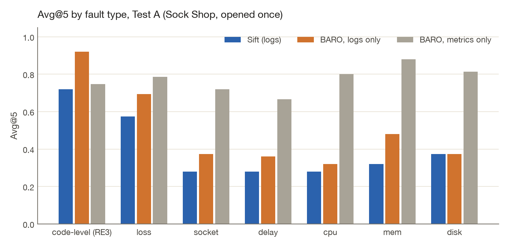
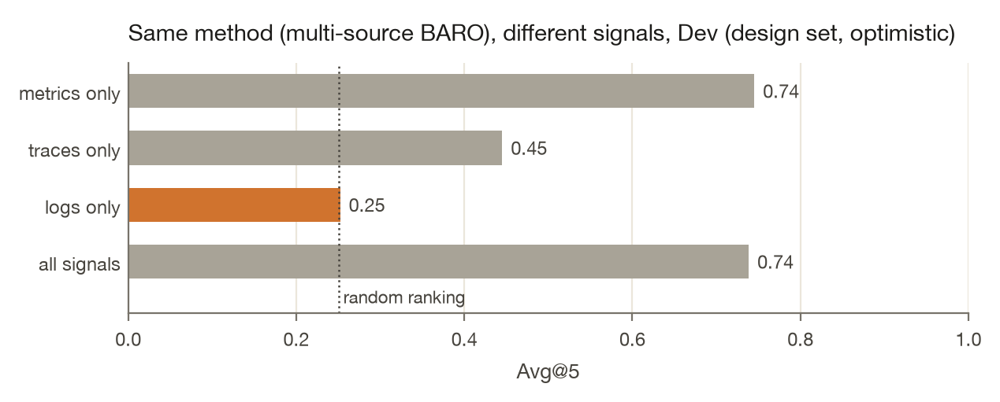

# Results

Every number here is filled by [`evals/src/sift_evals/report.py`](../evals/src/sift_evals/report.py) from `results/`. CI regenerates this file and fails if it drifts. The short version is the [README](../README.md).

Dev is Online Boutique (tuning only). Test A is Sock Shop. Test B is Train Ticket. Each test set was opened once, after [`PREREGISTRATION.md`](../PREREGISTRATION.md) was committed. Test B also needed the tag `q3-frozen`.

Avg@5 is the mean of AC@1 through AC@5, RCAEval's definition, at service level. A failed run scores as a miss at every k. Intervals are 95% paired cluster bootstraps over (service, fault), 2000 resamples, seed 0.

## Test B (Train Ticket, opened once)

{{tb_cases}} cases. A random ranking scores {{tb_chance_avg5}}.

{{tb_table}}

{{tb_no_logs}} case ships with no `logs.parquet`. Every logs-only method scores it as a miss. RCAEval's own code fails on one other case for two baseline variants. That is a miss too. v1's AC@1 is {{tb_v1_ac1}} and v2's is {{tb_v2_ac1}}. v2 minus v1 is {{tb_v2_v1_diff}} (95% CI {{tb_v2_v1_ci}}). v1 minus logs-only BARO is {{tb_v1_logs_diff}} (95% CI {{tb_v1_logs_ci}}).

{{tb_fault_table}}

{{tb_concentration_table}}

{{tb_predictions_table}}

### Watch (same configuration, alarm time not given)

{{tb_q3_table}}

{{tb_q3_text}}

A false issue opened before the fault hides a later real one, because repeats for the same service and sensor count once. The gate removes some of those early issues, so its recall can exceed the raw sensors. Train Ticket is noisier ({{tb_q3_false_raw}} false issues per hour raw). The five-fold prediction is the failed row above.

## Test A (Sock Shop, opened once)

{{head_cases}} cases. A random ranking scores {{chance_avg5}}.

{{head_table}}

{{fault_table}}

[`manifests/rcaeval-test_a.json`](../manifests/rcaeval-test_a.json) has no `traces.parquet` entries, so the traces-only row matches chance ({{chance_avg5}}). Logs-only BARO's lift is {{logs_baro_lift}} here and {{dev_logs_lift}} on Online Boutique.

{{evidence_table}}

On Dev, most correct top-1 picks were restart or redeploy lines. On Sock Shop, none were. v1 ranked `{{sift_top1_service}}` first in {{sift_top1_share}} of cases. Paired difference, v1 minus logs-only BARO: {{paired_diff}} (95% CI {{paired_ci}}).

{{concentration_table}}

{{predictions_table}}

After Test A, an empty ranking had been scored as 0 instead of chance. The baselines were re-run. Sift's numbers did not change. The front-end diagnosis is post-hoc. On Test B the first baseline run shared a cache directory with a stale process and was discarded before scoring. The agent run was restarted once after a reboot, before it wrote output.

## Dev (Online Boutique, design set)

v1 Avg@5 {{dev_sift_avg5}} against logs-only BARO {{dev_logs_avg5}}. v2 Avg@5 {{v2_dev_avg5}}, AC@1 {{v2_dev_ac1}}. The v2 grid spanned {{v2_tuning_min}} to {{v2_tuning_max}} ([`results/q1/dev/tuning_v2.json`](../results/q1/dev/tuning_v2.json)). v1 weights were chosen from {{tuning_trials}} settings, Avg@5 {{tuning_min}} to {{tuning_max}}, `{{tuning_chosen}}` ([`results/q1/dev/tuning.json`](../results/q1/dev/tuning.json)). Re-running v1 after the v2 flag changed {{v1_repro}} rankings ([`results/q1/dev/v1_reproduction.json`](../results/q1/dev/v1_reproduction.json)).

{{dev_table}}

{{dev_evidence_table}}

{{dev_concentration_table}}

`productcatalogservice` writes any log line in {{pc_coverage}} of its Dev root-cause cases ([`results/audit/audit.json`](../results/audit/audit.json)).

## Watch on Dev

120 cases, 300 s detection window, `DEFAULT_WATCH_CONFIG` in [`engine/src/detect/watch.ts`](../engine/src/detect/watch.ts), not tuned. Model: {{q3_model}}.

{{q3_table}}

The gate takes false issues from {{q3_false_raw}} to {{q3_false_gate}} per hour (about {{q3_false_cut}}-fold). The model answered "open" to {{q3_open_share}} of the gate-passed signals, and named a different service in {{q3_renamed}} of answers. Usable answers: {{q3_usable}}. Median {{q3_latency}}, {{q3_tokens_in}} tokens in, {{q3_tokens_out}} out. Right-service detection moved from {{q3_recall_correct_gate}} (gate) to {{q3_recall_correct_model}} (model). {{q3_calls}} model calls.

## Durability, collector, throughput

These are the committed harness outputs.

| Check | Result | File |
|---|---|---|
| SIGKILL under load, restart, resend unknown batches | {{crash_runs}} runs, {{crash_records}} acked records, {{crash_lost}} lost, {{crash_dup}} duplicated | [`results/infra/crash.json`](../results/infra/crash.json) |
| Of which random / named steps | {{crash_random}} random; {{crash_points}} | same |
| Same harness with recovery deliberately broken | {{sens_lost}} of {{sens_acked}} records lost across {{sens_runs}} runs | [`results/infra/crash_sensitivity.json`](../results/infra/crash_sensitivity.json) |
| Temporal worker killed mid-investigation | {{durable_summary}} | [`results/infra/durable.json`](../results/infra/durable.json) |
| Stock Collector, default exporter | {{collector_image}}: {{collector_received}} of {{collector_lines}} lines, {{collector_missing}} missing, {{collector_dup}} duplicated. {{collector_trimmed}} lines arrive right-trimmed because `filelog` trims trailing whitespace | [`results/infra/collector.json`](../results/infra/collector.json) |

The durability claim is: no acknowledged record lost or duplicated on process crash, for a sender that retries with a batch id inside 10 minutes. Acks follow `fsync`. Power-loss durability is not claimed. A stock Collector sends no batch id, so for it the claim is at-least-once.

| Throughput, {{machine}}, {{tp_records}} real lines, one run | |
|---|---|
| Direct append (WAL fsync + mining) | {{tp_direct}} records/s |
| OTLP/HTTP protobuf, 8 senders | {{tp_http}} records/s |
| Ack latency, 1,000-record batches | p50 {{tp_p50}} ms, p99 {{tp_p99}} ms |
| Ack to queryable | p99 {{tp_fresh_p99}} ms |

Source: [`results/infra/throughput.json`](../results/infra/throughput.json). Not extrapolated.

## What the store costs (Loghub-2.0)

Loghub-2.0 (Jiang et al., ISSTA 2024; Zenodo 8275861, CC-BY-4.0). {{q2_systems}} systems, {{q2_lines}} lines, {{q2_raw_gb}} GB raw. Each raw file goes through the store and through gzip, zstd, and ClickHouse. Every stored line is rebuilt and the SHA-256 of that stream is compared with the input. Sizes are MB. Machine: [`results/q2/environment.json`](../results/q2/environment.json).

{{q2_table}}

Lossless on {{q2_lossless}} systems. The store is {{q2_summary}}. gzip -6 is {{q2_ratio_gzip}}× smaller than raw. ClickHouse ZSTD(3) is {{q2_ratio_ch}}×. Grouping accuracy averages {{q2_ga_content}} on the benchmark's message text and {{q2_ga_full}} on the full line the store keeps. The WAL column is a second copy: it is not deleted after commit. {{q2_not_run}}
